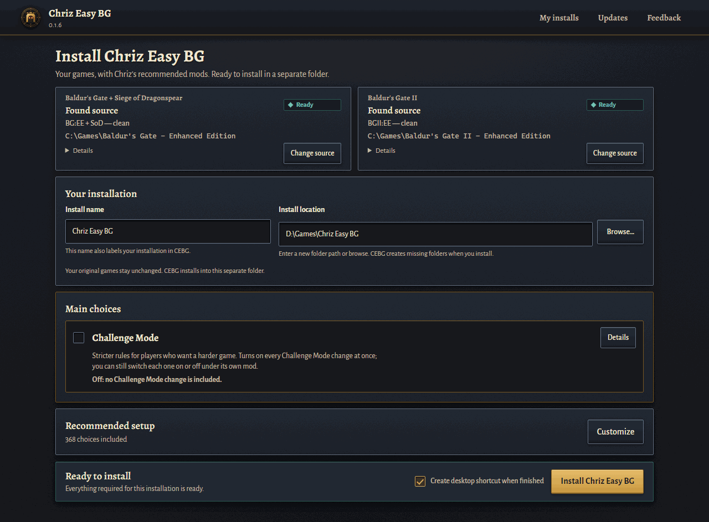
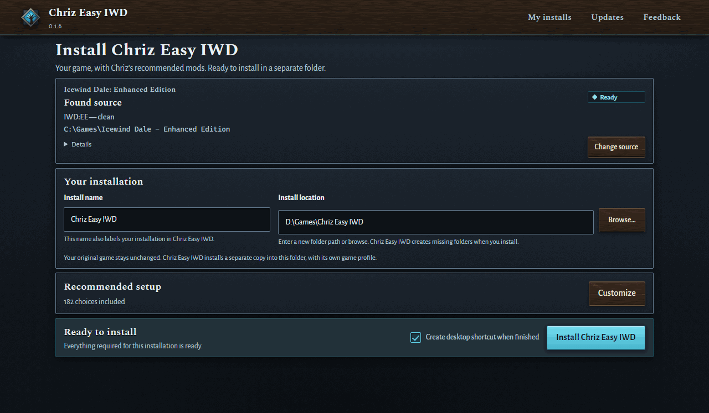

# Chriz Easy BG & Chriz Easy IWD

Shared desktop installer, Rust orchestration engine, and curated recipes for both Infinity Engine
collections built from this repository's `main` branch:

- **Chriz Easy BG** — One-click Windows installer for **Baldur's Gate: Enhanced Edition + Siege
  of Dragonspear + Baldur's Gate II: Enhanced Edition** joined via **EET** (app `v0.1.7`,
  collection `0.1.4`: 468 default components across 70 install runs and 56 mods).
  - Player Guide & Downloads: **[bg.chrizfader.org/collection](https://bg.chrizfader.org/collection)** · **[Latest Release](https://github.com/Chrizhermann/chriz-easy-bg/releases/latest)**
- **Chriz Easy IWD** — One-click Windows installer for **Icewind Dale: Enhanced Edition** (app
  `v0.1.16`, collection `0.1.17`: 145 default components across 34 install runs and 33 mods, with
  18 recruitable companions).
  - Player Guide & Downloads: **[bg.chrizfader.org/iwd](https://bg.chrizfader.org/iwd)** · **[Latest Release](https://github.com/Chrizhermann/chriz-easy-iwd/releases/latest)**

> **Looking to play?** Download signed Windows installers from the player pages above or from the
> distribution repositories ([`chriz-easy-bg`](https://github.com/Chrizhermann/chriz-easy-bg) ·
> [`chriz-easy-iwd`](https://github.com/Chrizhermann/chriz-easy-iwd)). This repository hosts the
> source code and recipes, not installer binaries or third-party mod archives.

---

## Part 1: For Players

<p align="center">
  
  
</p>

Both installers turn a multi-hour manual mod order into a guided setup while keeping your
original games safe:

- **One-click clean copy:** Automatically detects your clean `2.7.3.0` game folder(s) (English
  Steam is tested; GOG, Beamdog, and other Windows copies install as *Less tested*), copies them
  into a new destination folder on NTFS, exFAT, or FAT32 drives, and keeps an isolated Documents
  profile so your original games and saves stay untouched.
- **Recommended or Customize:** Start straight away with **Chris's Recommended** choices, or open
  **Customize** to pick a UI theme, add optional quests or companions, toggle **Challenge Mode**
  (Chriz Easy BG), or insert advanced manual-mod pauses.
- **Pause, resume & safe recovery:** Every mod download is verified by exact SHA-256 checksum. You
  can **Pause after current mod** at any time and continue later from **My installs**, while guided
  prompts handle changed downloads or single component errors without wiping finished work.
- **Hotpatches & BuffBot updates:** Update **BuffBot** in place with a full backup and **Undo** in
  both apps, apply save-compatible **Hotpatches** in **Chriz Easy IWD**, update the installer app
  itself from **Updates**, and optionally launch with **BG Radar Overlay**.
- **Built-in diagnostics & support:** Use **Export diagnostics** (with Windows user and computer
  names redacted) or **Feedback** / **Report this problem** to prepare a clean report for GitHub
  or [ChrizFader's Discord](https://discord.gg/RtXjRzy68k). See
  [docs/troubleshooting.md](docs/troubleshooting.md) for backup and recovery help.

---

## Part 2: Architecture, Layout & For Developers

### Bundle the recipe, not the mods

Third-party mods are **never** redistributed in this repository or in release packages. Instead,
each product bundles versioned recipes that pin upstream download URLs, byte sizes, SHA-256
hashes, install order, and curated component selections. Every mod retains its original author's
rights and license.

Both products build from the same `main` branch and Rust/Tauri codebase, selecting product
identity, UI themes (`bg.css` Candlekeep / `iwd.css` Kuldahar), recipes, and updater feeds
through the build configuration:

| Product | Tauri configuration | Frontend mode | Bundled recipe | Distribution repo | Update feed |
| --- | --- | --- | --- | --- | --- |
| **Chriz Easy BG** | `app/src-tauri/tauri.conf.json` | default | `recipes/curated-full-current/` | [`chriz-easy-bg`](https://github.com/Chrizhermann/chriz-easy-bg) | `alpha/latest.json` |
| **Chriz Easy IWD** | `app/src-tauri/tauri.iwd.conf.json` | `iwd` | `recipes/iwd-current/` | [`chriz-easy-iwd`](https://github.com/Chrizhermann/chriz-easy-iwd) | `updates/latest.json` |

### Repository layout

```text
app/                          Tauri v2 desktop frontend, Candlekeep/Kuldahar themes, native shell
engine/                       Rust workspace crate: discovery, preflight, acquisition, WeiDU runner, receipts
manifest/                     BG collection metadata, artifact pins, own-mods.toml, ground-truth install-order.tsv
recipes/curated-full-current/ Active Chriz Easy BG (EET) curated recipe and preset
recipes/iwd-current/          Active Chriz Easy IWD recipe, preset, and release ledgers
hotpatches/                   Separate BG (BuffBot updates) and IWD (hotpatches + BuffBot updates) catalogs
docs/                         Build/release guides, live handover, per-mod curation catalogs, acceptance records
```

### Developer guides & quick checks

- **[Windows Build & Check Guide](docs/BUILDING.md)** — Prerequisites (Rust `1.97.1`, Node.js
  `22.12+`, Python `3.11+`, MSVC Build Tools), IWD flavor build commands, and CI packaging details.
- **[Live Handover & Status](docs/handover.md)** — Maintained release ledger, recent merges, and
  current development queue.
- **[Own-Mod Pin Policy](docs/own-mod-pins.md)** — Rules and CI checks (`tools/own_mod_pins.py`)
  keeping first-party mods synchronized across both installers.
- **[Mod Link Check](docs/mod-link-check.md)** & **[Component Curation](docs/curation/components/README.md)**
  — Automated upstream link verification and per-mod curation choices.

Run local checks without signing keys from PowerShell on Windows:

```powershell
Set-Location app; npm.cmd ci; npm.cmd run check; Set-Location ..
cargo fmt --all -- --check
cargo test --locked --workspace --no-fail-fast
cargo clippy --locked --workspace --all-targets -- -D warnings
python -m unittest discover -s tools/tests
```

### Development guardrails

- Read `AGENTS.md` (or `CLAUDE.md`) and [docs/handover.md](docs/handover.md) before making changes,
  and work in an isolated Git worktree.
- Treat local reference game installs and mod archive directories as strictly **read-only**.
- Run Cargo from **PowerShell on Windows** (avoiding Git Bash `link.exe` shadowing MSVC).
- Never hand-edit `manifest/install-order.tsv`; regenerate it only from a verified live `WeiDU.log`.
- Follow the **We Overwrite** policy across first-party mods and tooling: write the decided
  outcome cleanly rather than gating behavior on pre-existing game data.

### License

Chriz Easy BG and Chriz Easy IWD's own source code, recipes, and tooling are licensed under the
**MIT License** — see [LICENSE](LICENSE).

Third-party Rust/npm dependencies and bundled open-source assets (including **UnRAR** extraction
terms via `unrar_sys`, the short **EET** compatibility excerpt under GNU GPLv3, and **SIL OFL 1.1**
theme fonts `Alegreya`, `Alegreya Sans`, and `Spectral`) retain their respective licenses; see
[THIRD_PARTY_NOTICES.md](THIRD_PARTY_NOTICES.md). Third-party mods retain their original authors'
rights and are never included in the installer bundle.
